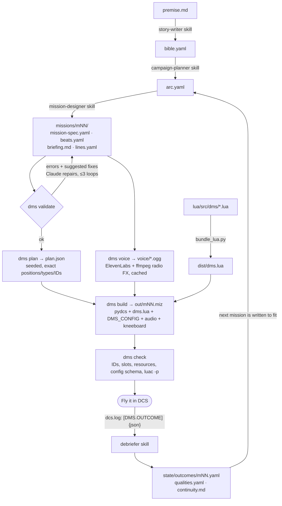

# DMS architecture

Status: **approved 2026-10-27**. It is being built on the `rebuild` branch.
This document was finalized from [`rebuild/ARCHITECTURE-PROPOSAL.md`](rebuild/ARCHITECTURE-PROPOSAL.md),
which is kept for history. The evidence behind it is in
[`rebuild/RESEARCH-NOTES.md`](rebuild/RESEARCH-NOTES.md). The interfaces are in [`CONTRACTS.md`](CONTRACTS.md),
and the decisions are recorded in [`adr/`](adr/README.md).

## Vision

You start from a story, which can be historical, adapted, fictional or fantasy. DMS turns it into a
campaign of playable, **replayable** DCS World missions. Each mission comes with briefings,
kneeboards and voiced radio chatter that react to what actually happens in the cockpit.

## Approved decisions (2026-10-27)

1. **Own Lua core on the raw DCS API.** MOOSE, MIST and Skynet are optional, pinned plugins that
   the core never depends on ([ADR 0003](adr/0003-own-lua-core-optional-moose.md)).
2. **Restructure in place on the `rebuild` branch.** The old code moved to `legacy/` and is
   read-only reference. Its behaviours are ported module by module, with tests.
3. **Git LFS** holds `.miz` fixtures and audio ([ADR 0010](adr/0010-git-lfs-for-binaries.md)).
4. **LLMs write structured files, and code compiles them.** No step interprets prose
   ([ADR 0006](adr/0006-llm-writes-validated-files.md)).

## Four pillars

| Pillar | What it is | Who does it |
|---|---|---|
| 1. Story | premise → story bible → campaign arc → mission beats | Claude Code skills, writing schema-validated YAML |
| 2. Generator | MissionSpec → validated BuildPlan → `.miz` | Deterministic Python: pydcs builds, lupa edits |
| 3. Runtime | Dynamic, replayable behaviour inside DCS | DMS Lua core, driven by a generated `DMS_CONFIG` |
| 4. Voice | beat lines → ElevenLabs → radio FX → `.ogg` in the `.miz` | Python stage (cached) plus the voice-director skill |

## Pipeline

Each mission is generated **after** the previous one has been flown. Branching costs nothing, and
the campaign reacts to what really happened.

## Randomness split ([ADR 0007](adr/0007-randomness-split.md))

**Python decides the space of possibilities, and Lua picks the instance each time you play.**

- **Python** is seeded, inspectable and reproducible. It decides:
  - theater, time and weather
  - objectives, unit templates and loadouts
  - validated spawn zones (on land and reachable by road)
  - pool contents and weights
  - beats, the voice map and budgets

  The seed is stored in the `.miz`.
- **Lua** is unpredictable on every play. It decides:
  - which pool members appear and where
  - timing jitter and director pacing
  - pop-up SAMs and reinforcement waves
  - which optional beats fire
  - hidden difficulty adaptation

## Pillar 3: DMS Lua runtime

The runtime ships as two files: `dist/dms.lua`, which is concatenated in `lua/manifest.txt` order
and version-stamped ([ADR 0004](adr/0004-concatenation-bundler.md)), and a generated
`dms_config.lua` (`DMS_CONFIG = {...}`). It runs on the raw DCS API through safe wrappers. Lua 5.1
quirks are documented in [`reference/dcs-scripting-gotchas.md`](reference/dcs-scripting-gotchas.md).

| # | Module | Responsibility |
|---|---|---|
| 1 | core | `DMS.Log` (prefixes, debug flag, `[DMS.OUTCOME]`), `safeCall` (xpcall + traceback), version banner |
| 2 | clock | The **only** scheduler. Callbacks are pcall-guarded and always re-armed. Tests use a fake clock |
| 3 | rng | Entropy seeding, weighted pick, pickN, shuffle-bag (no repeats), jitter |
| 4 | bus | The **only** `world.addEventHandler`. Turns DCS events into typed events (`unit.dead` deduplicated, `player.spawned` via BIRTH) |
| 5 | registry | Unique names, live-group tracking, unit budgets |
| 6 | spawner | Template + zone → `coalition.addGroup`, with surface, LOS and player-distance checks. Waits 1 s before tasking |
| 7 | ground | Valid routes (≥2 points), StopRoute/resume, FireAtPoint, ROE/alarm by domain, hunt/intercept, stuck watchdog |
| 8 | director | Per-flight intensity, BUILD_UP → PEAK → RELAX, spawn budget per minute, hidden difficulty |
| 9 | encounters | pool, ambush_sam, waves, hunt, convoy, cap. Triggered by proximity, beat, director or time |
| 10 | narrative | Storylet/beat engine: preconditions on qualities/flags/events, priority, cooldowns, effects, outcomes |
| 11 | comms | Voice and subtitle queue (no overlap), per-group sound, radioTransmission, F10 per-group menus |
| 12 | intel | Fog of war (spawn-time `hidden` plus F10 marks on detection), BDA ([ADR 0008](adr/0008-fog-of-war-hidden-plus-marks.md)) |
| 13 | ambient | Friendly base traffic (parked departures, arrivals, apron vehicles, pattern helo, statics) around the player's airbases; spawned when a player is near, destroyed when they leave (hysteresis). Own budget: not in the registry, invisible to the director and intel |

Modules 6–13 build only on the core API (1–5) and the raw DCS API. `init.lua` calls each module's
`DMS.<Module>.start()` when `DMS_CONFIG` is present.

**Optional plugins** (`lua/plugins/`, pinned versions, see `lua/plugins/PINS.md`) are loaded before
`dms.lua` when a spec asks for them (`plugins: [skynet]`); DMS adapters for them
(`lua/plugins/adapters/`) load after `dms.lua` and no-op without the plugin
([ADR 0013](adr/0013-vendored-plugins-and-adapters.md)):

- Skynet-IADS (needs MIST)
- MOOSE (for CTLD, CSAR, ATIS and EasyGCICAP)

**Legacy library:** the 72 old modules in `legacy/lua-library/` compile under Lua 5.1 since
commit 7744bb4. They are kept as reference only.

## Pillar 1: Story (Claude Code skills)

| Skill | Input → output |
|---|---|
| story-writer | premise (+ interview, + web research for historical stories) → `bible.yaml` with `mode`, cited claims, faction→DCS mapping and character voice profiles |
| campaign-planner | bible → `arc.yaml`: 5–8 missions, dramatic questions, qualities and branches |
| mission-designer | arc entry + state → `mission-spec.yaml`, `beats.yaml`, `briefing.md` (5-paragraph order) and `lines.yaml` |
| voice-director | lines → render plan + cost estimate → `dms voice` |
| debriefer | dcs.log or a questionnaire → outcomes, qualities and `continuity.md` |
| dms-build | Runs validate → plan → voice → build → check end to end |

Files are the memory. The bible, the arc and the append-only continuity ledger are canonical, and
skills read them instead of remembering. Historical claims carry `{claim, source_url, confidence}`,
and real people never get invented quotes.

## Pillar 2: Generator

- **Building new missions** uses pydcs, pinned exactly ([ADR 0001](adr/0001-pydcs-for-generation-only.md)).
- **Editing existing missions** uses lupa to parse the mission into a dict, then serializes it back
  deterministically and re-zips it ([ADR 0002](adr/0002-lupa-dict-round-trip-for-editing.md)).
  pydcs load/save is never used on user missions.
- **Schemas** are pydantic v2 models in `dms_core.schemas`. The LLM writes a declarative
  `MissionSpec`, and `dms plan` turns it into an exact `BuildPlan` and a `RuntimeConfig`.
- **Grounding tools** come from pydcs data: `find_airbase`, `list_units(era, coalition, role)` and
  `list_loadouts`. The LLM picks areas and roles, and Python picks coordinates and types.
- **Interface:** the `dms` CLI (typer) plus skills come first. `dms-mcp` is a thin FastMCP stdio
  wrapper with six tools (validate, plan, build, check, schema, campaign_status) that call
  `dms_core` / `dms_gen` in-process ([ADR 0005](adr/0005-cli-and-skills-before-mcp.md)).
  CLI commands are listed in [CONTRACTS](CONTRACTS.md#file-formats).

## Pillar 4: Voice

- The line catalog is keyed by **beat**, with 3–5 variants per line. At runtime a shuffle-bag picks
  among them so lines don't repeat.
- Each character has a voice profile: an ElevenLabs voice ID or a Voice Design v3 prompt, plus
  brevity rules.
- Lines are rendered with Eleven v3 using audio tags. Overheard exchanges use Text-to-Dialogue.
- ffmpeg applies radio FX: a 300–3400 Hz band-pass, compression and a squelch tail. Output is `.ogg`.
- The cache lives at `~/.dms/tts-cache/<sha256>.ogg`, keyed on `sha256(voice_id|model|text|fx_preset)`.
- Audio files go in `l10n/DEFAULT/`, are registered in `mapResource`, and are referenced by a
  keeper trigger so the editor doesn't strip them.

## Repo layout

| Path | Contents |
|---|---|
| `packages/dms-core` | Schemas, miz I/O (zip + lupa round-trip), catalog |
| `packages/dms-gen` | plan + build (pydcs), Lua injection, kneeboard |
| `packages/dms-voice` | ElevenLabs, ffmpeg FX, cache |
| `packages/dms-cli` | The `dms` command |
| `packages/dms-mcp` | `dms-mcp` FastMCP stdio server (6 tools, thin wrapper over core/gen) |
| `lua/src/dms/`, `lua/manifest.txt` | Runtime modules and their load order |
| `lua/spec/`, `lua/mocks/` | Lua specs (run via pytest + lupa) and the DCS mock with a fake clock |
| `lua/plugins/` | Pinned optional MOOSE, MIST and Skynet |
| `tools/bundle_lua.py` | Lua bundler → `dist/dms.lua` |
| `data/catalog/` | Unit types, group templates and mission types (YAML) |
| `campaigns/<slug>/` | Story-first workspaces |
| `examples/`, `tests/fixtures/` | Sample missions, `.miz` fixtures (LFS), prompts, golden specs |
| `.claude/skills/` | Story and build skills |
| `legacy/` | Pre-rebuild code and docs, read-only |

## Quality gates ([ADR 0009](adr/0009-definition-of-done-requires-flight.md))

- **CI** (`.github/workflows/ci.yml`):
  - ruff (lint + format), mypy strict, pytest (including the Lua specs via lupa)
  - `luac -p` (5.1) over the sources and the bundle
  - StyLua, plus luacheck (advisory for now)
- **Lua scenarios:** run with the fake clock across 1000 seeds.
- **Golden prompt suite:** ~30 premises and specs, with structural assertions on the built `.miz`.
- **Definition of Done:** a runtime feature is done only after **all** of the following:
  - CI is green.
  - A DCS smoke test passes (a headless dedicated-server log scrape where possible).
  - A manual check in the cockpit confirms the behaviour.

Nothing is marked done on the strength of code alone.

## Roadmap

See [`../ROADMAP.md`](../ROADMAP.md).
